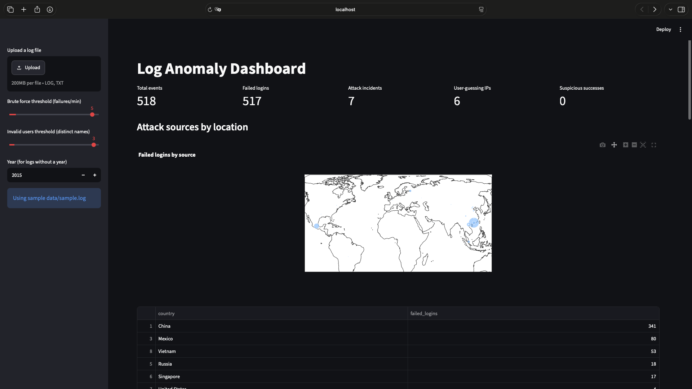

# Log Anomaly Detection Platform

A lightweight platform that parses SSH authentication logs, detects suspicious
activity using rule-based and machine-learning methods, and visualizes the
results in an interactive dashboard.

**Live demo:** https://log-anomaly-platform.streamlit.app

> Do not upload sensitive logs to the public demo: public IPs found in a
> log are sent to ip-api.com for geolocation.

## Features

- **Multi-format parser**: supports a custom `YYYY-MM-DD HH:MM:SS sshd ...`
  format and standard syslog (e.g. OpenSSH logs from LogHub).
- **Brute-force detection**: flags IPs with many failed logins per minute,
  with a configurable threshold.
- **Incident grouping**: merges consecutive per-minute alerts into a single
  attack incident (start, end, total failures) to reduce alert noise.
- **Username guessing detection**: flags IPs that try many distinct invalid
  usernames, catching slow attackers that stay under the per-minute threshold.
- **Suspicious success detection**: flags a successful login that follows
  many failed attempts from the same IP within a short time window.
- **Machine learning**: Isolation Forest over per-IP, per-minute features
  (events, failures, failure ratio) to surface unusual behavior.
- **GeoIP attack map**: geolocates attacker IPs with MaxMind GeoLite2 and
  shows failed logins per source and per country (optional).
- **Interactive dashboard**: file upload, adjustable thresholds, KPI metrics,
  timeline, top attackers, and alert tables.


## Architecture

```
Raw logs --> Parser --> Structured DataFrame --> Detectors --> Dashboard
(file upload)  (regex)   (time, status, user,    (rules + ML)   (Streamlit
                          ip, invalid)                           + Plotly)
```

| File | Role |
|---|---|
| `detect.py` | Parsing, detection logic, and GeoIP lookup |
| `dashboard.py` | Streamlit UI and charts |
| `generate_logs.py` | Generates synthetic logs with an injected attack |
| `data/sample.log` | Real SSH sample (OpenSSH_2k from LogHub) so the dashboard works out of the box |
| `requirements.txt` | Python dependencies |

## Installation

Requires Python 3.12.

```bash
git clone https://github.com/Rayansalim670/log-anomaly-platform.git
cd log-anomaly-platform
python3.12 -m venv venv
source venv/bin/activate
python -m pip install -r requirements.txt
```

On Windows, activate the environment with `venv\Scripts\activate`.

## Usage

Launch the dashboard:

```bash
streamlit run dashboard.py
```

The dashboard opens with the bundled `data/sample.log`, which is a copy of
`OpenSSH_2k.log` from the [LogHub](https://github.com/logpai/loghub) dataset
(real SSH logs, year 2015). Upload your own SSH log from the sidebar. For logs
without a year (syslog format), set the year in the sidebar.

Run the detectors from the command line:

```bash
python detect.py
```

Generate a fresh synthetic log (optional):

```bash
python generate_logs.py
```
## Tests

```bash
python -m pip install pytest
python -m pytest -v
```
## Tests

```bash
python -m pytest -v
```

The suite covers the parser (both log formats, invalid users, empty input),
brute-force detection and its threshold, incident grouping, and suspicious
success detection.

## GeoIP map

The attack map works out of the box: attacker IPs are located through the
free ip-api.com service (public IPs only, up to 40 per run). For faster,
offline lookups, download **GeoLite2 City** from maxmind.com (free account)
and place `GeoLite2-City.mmdb` in `data/` (do not commit it; the license
forbids redistribution).

Note: with the online mode, public IPs found in your logs are sent to
ip-api.com. Do not upload logs containing sensitive addresses.


## Tested on

- Synthetic logs from `generate_logs.py` (injected brute-force attack followed
  by a successful login).
- Real SSH logs: `OpenSSH_2k.log` from LogHub.

## Detection results (OpenSSH_2k sample)

- 99.8% of authentication events were failures, a typical brute-force pattern.
- The top attacker produced 286 failed logins over about 10 minutes.
- Per-minute alerts were grouped into 7 attack incidents.
- Most failed logins originated from IPs geolocated to China and Mexico
  (GeoIP results show network location, not attacker identity).

## Limitations

- Supports `sshd` password authentication events only.
- Thresholds are static and tuned manually per dataset.
- Isolation Forest flags unusual behavior relative to the uploaded data, so
  results depend on the data mix. It is not a measure of severity.
- GeoIP shows where an IP is registered, which can be a VPN, proxy, or
  compromised host rather than the real attacker.
- No labeled ground truth, so precision and recall were not measured.

## Future work

- Email or webhook alerts (e.g. Telegram)
- Support for more log sources (Apache, Windows Event Log)
- Evaluation against labeled attack datasets

## License

MIT License. See [LICENSE](LICENSE).